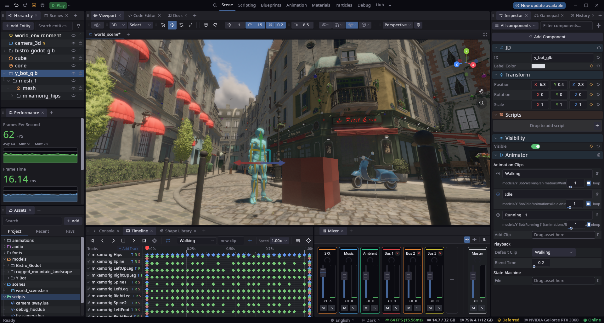

# Renzora Engine

A 3D and 2D game engine and visual editor built on <a href="https://bevyengine.org/" target="_blank" rel="noopener noreferrer">Bevy 0.20</a>. It's fully compatible with the Bevy plugin ecosystem and is itself modular: every system is a plugin you can add, remove, or replace. Use it as a standalone engine to build games out of the box, or treat it as a customizable foundation you can modify into your own bespoke engine.



> **Warning:** Early alpha. Expect bugs, incomplete features, and breaking changes between versions.

## Features

| Area | Features |
|---|---|
| **Editor** | Dockable panels with tabs, split panes and floating windows · up to four viewports · hierarchy, inspector, asset browser and console · translate, rotate and scale gizmos · infinite grid · camera presets · undo and redo · autosave · command palette · rebindable shortcuts · themes and fonts · built-in code editor · Play in its own process with live link · guided tutorial · UI scale and DPI support · runs on the web |
| **Rendering** | Physically based materials (clearcoat, anisotropy, transmission, parallax) · node material editor generating WESL · shader editor · Solari ray-traced global illumination with its own denoiser and ray-traced glass · DLSS upscaling and ray reconstruction · `.rvg` virtual geometry · Gaussian splatting · point, spot, directional and rectangular area lights · soft shadows, contact shadows, and cascade and bias controls · environment maps, skyboxes, light probes and parallax-corrected reflection probes · planar reflections · physical atmosphere · volumetric clouds · volumetric and distance fog · SSAO · SSR · bloom · auto exposure · depth of field · motion blur · tonemapping · MSAA, FXAA, SMAA, TAA and sharpening · order-independent transparency · forward decals · around 30 shader post effects (color grading, chromatic aberration, vignette, film grain, outline, CRT, toon and more) · Low, Medium and High quality tiers · mesh LOD with crossfade · texture streaming · GPU device-loss recovery |
| **World building** | Terrain sculpting and painting · foliage painting · spectral FFT ocean water · wind sway · tilemaps with composite objects and randomised painting · mesh modelling tools · shape library · level presets |
| **2D** | Sprites · sprite animation clips · dedicated 2D view · 2D lighting · 2D physics with Y-sorting |
| **Animation** | Animator with blend graphs, masks, transitions and events · retargeting · root motion · property animation with per-key easing · morph targets · facial animation · rigging tools · inverse kinematics · FBX animation import |
| **Physics and simulation** | Pluggable physics backends (Avian 3D and 2D bundled) · ragdolls · cloth · hair strands · parkour traversal and locomotion · navmesh pathfinding · GPU particles with an effect editor and effect library |
| **Scripting** | Rust scripts compiled as native plugins with full `&mut World` access, recompiled on save · pluggable language backends from the marketplace, several per project · hooks for ready, update, fixed-timestep update, UI, drawing, RPC, animation events, HTTP and player join/leave · rebindable input action map for keyboard, mouse and multiple gamepads · touch input with taps, pinch and twist · save slots · APIs for physics, animation, IK, particles, parkour, ragdolls, navigation and game UI |
| **Audio** | Own audio backend · mixer with buses and effects · spatial audio with distance falloff · pluggable audio backends |
| **UI** | Ember UI toolkit for the editor and games · game UI editor with markup templates · gamepad navigation of game menus · rich text · font switching and weights · SVG images |
| **Multiplayer** (alpha) | Client and headless dedicated server from one binary (`--server`) · replication and RPC over UDP · network panel |
| **XR** | Games in a VR headset over OpenXR (Quest Link, SteamVR) with a desktop mirror · headset editing mode (`cargo renzora xr`) |
| **Plugins** | Every engine system is a removable plugin · native plugins ship as source and compile on install · bundled plugins compiled into the binary · custom panels, inspectors, material nodes, post effects, and audio, physics, network and script backends · localization |
| **Assets and scenes** | BSN scene files · prefabs · scene thumbnails · glTF, FBX, OBJ, STL and PLY import with GLB compaction · hot reload · `.rpak` archives |
| **Exporting** | One binary is both editor and game · lean exports without unused features · Windows, Linux, macOS, Android, iOS and web, cross-compiled from one machine · built-in updater |
| **Marketplace** | Browse and install plugins, scripts and assets in the editor · publish from the Publish panel · creator credits |

## Planned

This list changes as work lands. See `RELEASE_NOTES.md` for what each nightly actually contains.

| Feature | Status |
|---|---|
| Accessibility (screen readers) for game UI | Next up |
| IME text entry for Chinese, Japanese and Korean input | Next up |
| GPU occlusion culling, clustered decals, light cookies and irradiance volumes | Next up |
| Multiplayer: client prediction, secure handshake, avatar spawning, more transports | In progress |
| Facial rigging and posing | In progress |
| Code editor: minimap, code folding and undo history | In progress |
| Shared environment and lighting across multiple viewports | In progress |
| Unified world environment component | In progress |
| Translating the remaining editor text | In progress |
| Cinematic sequencer for cutscenes | Later |
| Behavior trees and AI perception | Later |
| Crowd avoidance for navmesh agents | Later |
| Camera rigs with shake, blending and rails | Later |
| Spline mesh tools for roads, pipes and fences | Later |
| Vertex and mesh painting | Later |
| Vehicle physics | Later |
| Data tables | Later |
| Lightmap baking | Later |
| Level streaming for large worlds | Later |
| In-editor profiler | Later |
| HDR display output and video capture | Later |
| Sprite rendering moving to `SpriteMesh` | Bevy 0.21 port |
| Ambient lights folding into environment-map lights | Bevy 0.21 port |
| Assets becoming entities | Bevy 0.21 port |
| Upstream `.bsn` file format and entity inspector | Bevy 0.21 port |

## Getting Started

**Prerequisites:** <a href="https://rustup.rs/" target="_blank" rel="noopener noreferrer">Rust</a>.

```bash
git clone https://github.com/renzora/engine.git
cd engine
cargo renzora             # build, stage dist/, and launch the editor
```

That's the whole setup. `cargo renzora` builds the workspace natively, stages a complete engine into `dist/<platform>/`, and launches the editor from it. The first build is slow; every one after that is incremental.

On **Linux** you also need the usual graphics/audio dev headers:

```bash
sudo apt install pkg-config libx11-dev libxcursor-dev libxrandr-dev libxi-dev \
  libwayland-dev libxkbcommon-dev libasound2-dev libudev-dev
```

### Build Commands

| Command | What it does |
|---|---|
| `cargo renzora` | Build, stage `dist/<platform>/`, and launch the editor. |
| `cargo renzora dist` | Build and stage without launching. |
| `cargo renzora profile` | Profiling build with Tracy instrumentation compiled in. |
| `cargo renzora sync` | Regenerate the plugin wiring from the `renzora::add!` declarations. |
| `cargo renzora remove <crate>` | Delete a plugin crate and every reference to it. |

Building the editor always builds the runtime too. The runtime doubles as a dedicated server: run it with `--server`.

Iterate with `cargo check --profile dist` and `cargo clippy --profile dist`; run tests with `cargo test --profile dist -p <crate>`. Always pass `--profile dist`. A bare cargo command builds a second full set of artefacts under `target/debug/`, and this workspace is far too large for two of them.

Shipping a game for a platform you're not sitting at (a macOS, Android, or web build from a Windows box) is part of the editor's export system, covered in <a href="https://renzora.com/docs" target="_blank" rel="noopener noreferrer">the docs</a>.

## Documentation

Full documentation (getting started, scripting, UI, plugins, exporting, and more) lives on the website:

<strong><a href="https://renzora.com/docs" target="_blank" rel="noopener noreferrer">renzora.com/docs</a></strong>

## Supported Platforms

| Platform | Devices |
|----------|---------|
| Windows x64 | Desktop, PCVR (SteamVR, Oculus Link) |
| Linux x64 | Desktop, Steam Deck |
| macOS | Intel + Apple Silicon |
| Web (WASM) | Chrome 113+, Edge 113+, Firefox Nightly |
| Android ARM64 | Phones, tablets, Meta Quest, Pico, HTC Vive Focus |
| iOS | iPhone, iPad |
| Apple TV | Apple TV 4K, Apple TV HD |

## Supported File Formats

| Format | Type |
|--------|------|
| `.glb` / `.gltf` / `.fbx` / `.obj` / `.stl` / `.ply` | 3D models |
| `.rvg` | Virtual geometry models |
| `.bsn` / `.ron` | Scene files (`.ron` is the legacy format) |
| `.rs` / `.lua` | Scripts (Lua through a marketplace language plugin) |
| `.material` | Material graphs |
| `.wesl` / `.wgsl` | Shaders and post effects (`.wgsl` in the legacy dialect is translated) |
| `.anim` | Animation clips |
| `.vfx` / `.particle` | Particle effects (`.particle` is the legacy format) |
| `.png` / `.jpg` / `.hdr` / `.exr` / `.svg` | Textures and images |
| `.rmip` | Streamed, compressed textures |
| `.ogg` / `.mp3` / `.wav` / `.flac` | Audio (native only) |
| `.rpak` | Compressed asset archives |

## License

Dual-licensed under MIT or Apache 2.0.

- <a href="LICENSE-MIT" target="_blank" rel="noopener noreferrer">MIT License</a>
- <a href="LICENSE-APACHE" target="_blank" rel="noopener noreferrer">Apache License 2.0</a>
- <a href="https://github.com/renzora/engine/blob/main/docs/r1-alpha8/contributing/ai-policy.md" target="_blank" rel="noopener noreferrer">AI Policy</a>
