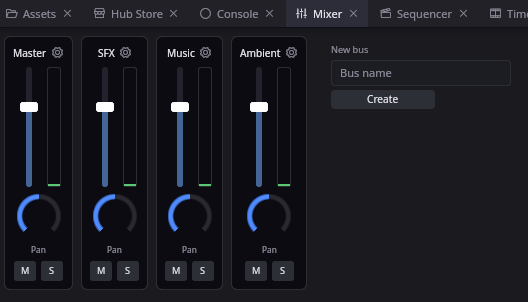

# Audio

Attach sounds to objects, play music and effects from scripts, and balance everything in the mixer.

Audio plays in the editor and in your exported game.

## Supported formats

| Format | Use it for |
|---|---|
| `.ogg` | Music and long clips. Small, and streams from disk. |
| `.mp3` | Music |
| `.wav` | Sound effects. Plays instantly, with no delay. |
| `.flac` | High-quality source audio |

The rule of thumb is OGG for music, WAV for sound effects.

Audio works on Windows, Linux and macOS, but not in a web build. Exporting to Web turns off sounds, the recorder and the mixer.

## Adding a sound to an object

1. Select the object.
2. In the Inspector, click **Add Component** and choose **AudioPlayer**.
3. Set **Clip** to your sound file.
4. Turn on **Autoplay** if it should start when the game runs.

<!-- screenshot: audio_source_inspector.png - the AudioPlayer component in the Inspector -->

| Setting | What it does |
|---|---|
| Clip | The sound file to play |
| Volume | How loud, where 1 is normal |
| Pitch | Higher is faster and squeakier, lower is slower and deeper |
| Looping | Repeat the clip |
| Autoplay | Start when the game runs |
| Bus | Which mixer channel it plays through |

There are more options too: random clip pools, volume and pitch jitter, fades and reverb.

A **clip pool** is worth knowing about. Fill the clips list and each trigger picks one at random, never the same one twice in a row. Footsteps and impacts sound far more natural that way.

## Making a sound feel 3D

Turn on **Spatial** and the sound comes from the object's position: louder up close, quieter far away. Campfires, machines, chatting characters.

Set **Spatial Min Distance** to roughly the size of the thing making the sound, around 3 metres for a campfire and half a metre for a whisper. Set **Spatial Max Distance** to how far it should still be heard.

### Where sound is heard from

By default, your game camera. You do not have to set anything up, and while editing it is the viewport camera, so you can fly around an emitter and hear it move.

Add an **AudioListener** component only when the ears belong somewhere other than the camera.

- **Third person.** The camera trails your character by a few metres, which puts their own footsteps in front of them. Put the listener on the character.
- **Strategy or top-down.** A camera fifty metres up is past most max distances, so the scene fades out as you zoom. Put the listener nearer the action.
- **Split screen.** With more than one camera, this is how you say which one hears.

A listener wins over the camera wherever it is. Untick **Active** to disable one without deleting it.

None of this affects ordinary non-spatial sounds, which play at the volume and pan you set wherever the listener is.

## Playing sounds from a script

Push an `AudioCommand` onto the queue.

```rust
use bevy::prelude::*;
use renzora::ScriptCtx;
use renzora_audio::{AudioCommand, AudioCommandQueue, AudioPlayer};

fn update(ctx: &mut ScriptCtx) {
    let me = ctx.entity();
    let Some(player) = ctx.get::<AudioPlayer>().cloned() else { return };
    let position = ctx.get::<GlobalTransform>().map(|t| t.translation()).unwrap_or_default();

    if let Some(mut queue) = ctx.get_resource_mut::<AudioCommandQueue>() {
        queue.push(AudioCommand::PlayEntity { entity: me, player, position });
    }
}
```

| Command | What it does |
|---|---|
| `PlaySound` | Play a one-shot from a path, on a bus |
| `PlaySound3D` | The same, positioned in the world |
| `PlayEntity` | Trigger an entity's AudioPlayer with all its configured settings, including its clip pool and spatial options |
| `PlayMusic` | Start a music track |
| `StopMusic` | Stop it |
| `CrossfadeMusic` | Fade from the current track to another |
| `PauseSound` / `ResumeSound` | Pause and resume a playing sound |
| `SetSoundVolume` / `SetSoundPitch` | Change a playing sound |
| `SetMasterVolume` | Set the Master bus volume |
| `SetBusVolume` / `SetBusMuted` | Set or mute any bus by its key |

`PlayEntity` is usually what you want for a sound that belongs to an object, because it honours everything you set up in the Inspector.

## Volume from a script or a settings menu

The mixer is a game setting, and the running game owns it. A script, or the volume sliders in your own in-game settings menu, can change any bus while the game runs, and the change is heard straight away.

From any script language:

| Function | Arguments | What it does |
|---|---|---|
| `set_master_volume` | `volume` | Set the Master bus. `1` is normal, `0` is silent, up to `1.5`. |
| `set_bus_volume` | `bus` (string), `volume` | Set a bus by its key: `"Sfx"`, `"Music"`, `"Ambient"`, or a custom bus's key. |
| `set_bus_muted` | `bus` (string), `muted` (bool) | Mute or unmute a bus. |

Bus keys match without regard to case, so `"music"` works. An unknown key changes nothing and logs a warning.

Master volume is the Master fader. There is no second master level hiding behind it, so a script setting it moves the fader in the Mixer, and a settings menu reading it sees what the fader shows.

In a Rust script, the settings live in `CurrentProject.config.audio`. Change them there, with the helpers in `renzora::audio::settings`:

```rust
use renzora::audio::settings;
use renzora::{CurrentProject, ScriptCtx};

fn update(ctx: &mut ScriptCtx) {
    if let Some(mut project) = ctx.get_resource_mut::<CurrentProject>() {
        // Only write when the value moves: a write marks the project changed.
        if settings::bus_volume(&project.config.audio, "Music") != Some(0.5) {
            settings::set_bus_volume(&mut project.config.audio, "Music", 0.5);
        }
    }
}
```

`settings::bus_volume`, `bus_muted` and `master_volume` read a value back, which is what a slider needs to start in the right place. Use the helpers rather than searching `buses` yourself: a project that never opened the Mixer has an empty list, and the helpers fill in the default board first.

In an exported game these changes last until the game quits. They never write `project.toml`. To remember a player's volume between runs, store it in your own save data and set it again on start.

## Choosing the output device

A game plays through the system's default output device unless it asks for another. A player who listens on headphones or an audio interface that is not the system default hears nothing until it does, so a settings menu with a device list is worth having.

In a Rust script, list the devices and pick one through the `AudioLink` resource:

```rust
use renzora::audio::AudioLink;

let mut link = ctx.world().resource_mut::<AudioLink>();
let outputs = link.list_devices().outputs;      // names, for a dropdown
if let Err(e) = link.set_output_device(Some(&outputs[0])) {
    warn!("could not switch: {e}");
}
link.set_output_device(None).ok();               // back to the system default
```

- The choice is not saved with the project, because a device name means hardware on one machine. Keep the player's pick in your own [save data](../scripting/saving.md) and set it again when the game starts.
- Asking before the device has opened is fine. A game's first frame can come before the sound device is ready, so the choice is kept and applied the moment it opens.
- Switching stops the sounds playing at that moment. Loaded clips stay loaded, and bus volumes carry over.
- A name that is not there is an error, and the current device keeps playing. If the chosen device is unplugged and the game is restarted, it opens on the default instead, and `link.info()` says which device is playing.

## The mixer

Every sound flows through a bus, a channel you can adjust on its own, so you can turn music down without touching sound effects.



Renzora starts you with four buses:

| Bus | For |
|---|---|
| Master | Everything at once. It sits apart, because everything feeds into it. |
| SFX | Sound effects |
| Music | Background music |
| Ambient | Environmental loops such as wind or rain |

On each strip, drag the **fader** to set volume, with the gain in dB underneath. Turn the **Pan** knob to move it left or right, or scroll over it: each notch moves 5% of the way, `Ctrl`+scroll 1%, and it stops on centre on the way past. **M** mutes and **S** solos.

### Pages

The tabs at the top left switch between three pages:

| Page | What it is for |
|---|---|
| Mixer | The channel strips: faders, pan, mute and solo |
| Routing | Where each bus goes, and how much it sends to the reverb and delay |
| Metering | Long meters with a peak hold and a clip light per bus |

### Laying the board out

On the Mixer page, the right end of the top bar sets the board's shape. Nothing here changes your sound.

| Control | What it does |
|---|---|
| Compact | Narrower strips, so more channels fit at once. The default. |
| Large | Roomier strips, with a bigger pan knob and a dB scale beside the fader |
| Horizontal | Lit while channels run as stacked rows; click to switch between rows and standing columns |
| Add bus | Adds a channel (see below) |

**Vertical** is the classic mixing desk, with the fader as tall as the panel allows. The longer a fader, the more precisely you can set it.

**Horizontal** lays each channel down as a row. It fits many more channels into a panel that is wide but short, which is the shape the Mixer ends up in when docked at the bottom.

Narrow the panel and a row gives ground in a fixed order: the name column first, then the fader and meter. Mute and solo stay reachable at any width.

Master keeps its place either way, at the far right in vertical and at the bottom in horizontal, always behind a dividing rule.

### Adding your own buses

Click **Add bus** in the top bar. You get a new channel immediately, already named and coloured. Point an AudioPlayer's **Bus** field at it and it is wired up.

Double-click the name at the top of a strip to rename it. `Enter` keeps the change, `Esc` abandons it.

Renaming is always safe. A bus has a permanent key that never changes and a name that is just a label, and sound is routed by the key. So renaming cannot strand an AudioPlayer pointing at it, including ones in scenes you do not have open.

The four built-in buses cannot be renamed, because their names are the keys the engine routes by.

### The strip menu

Right-click any strip. A strip is under a hundred pixels wide, so everything that is not a live control lives here.

| Entry | What it does |
|---|---|
| Rename | The same inline edit as double-clicking the name |
| Colour | A swatch grid. The current colour is ringed in white. |
| Input device | Capture a live microphone into this bus |
| Output device | Not used yet: every bus plays out of the game's one output device (see [Choosing the output device](#choosing-the-output-device)) |
| Delete bus | Removes a custom bus |

Devices are listed fresh each time you open the menu, so a microphone plugged in after starting the editor shows up straight away.

Each strip's colour shows as a bar across its top and a tint on its frame, so you can pick a channel out of a crowded board at a glance.

### Routing

By default every bus feeds Master. On the **Routing** page each bus has a row:

| Column | What it does |
|---|---|
| Output | The bus this one feeds: Master, or another bus. Turning a group bus down turns down everything routed into it. |
| Reverb send / Delay send | How much of this bus, after its fader, goes to the shared reverb and delay, 0 to 100. This adds to whatever each sound sends on its own. |
| Signal path | The whole route spelled out, such as `Footsteps › SFX › Master` |

The Output menu only offers buses that cannot create a loop, so you cannot route a bus back into one that already feeds it. A strip routed anywhere but Master shows where it goes under its name.

Solo follows the routing. Soloing a group plays everything routed into it, and soloing a bus inside a group keeps that group open so you still hear it. Deleting a bus sends whatever fed it to Master.

### Metering

The **Metering** page shows every bus on one long meter, post-fader. A white mark holds the highest peak for two seconds before it falls, with that peak in dB beside it. The **CLIP** light turns red if a bus goes over full scale, and stays on until you click it, or **Reset peaks** for all of them, so a clip on a page you were not looking at is not missed.

### The mixer is saved with your project

Bus volumes, panning, mute and solo, colours, routing, sends and every custom channel are stored in `project.toml`. They come back when you reopen the project, and they ship with your game.

An exported game builds the same board before the first scene loads, so an AudioPlayer routed to a bus called `Footsteps` plays on `Footsteps` rather than falling back.

Saving happens as you work. There is nothing to press.

Only the editor saves. When you press Play, the game runs as its own process, so a script that turns the music down during play does not change the mix saved in your project.

## Tips

- Use several clips for repeated sounds, with a little pitch and volume randomness.
- OGG for music, WAV for sound effects.
- You do not need an AudioListener unless the ears belong somewhere other than the camera.
- Pre-place your audio objects with Autoplay off, then trigger them from a script, to avoid a hitch when the sound first loads.
