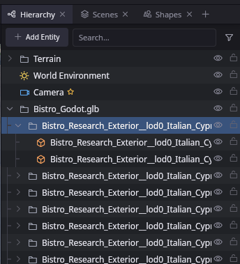
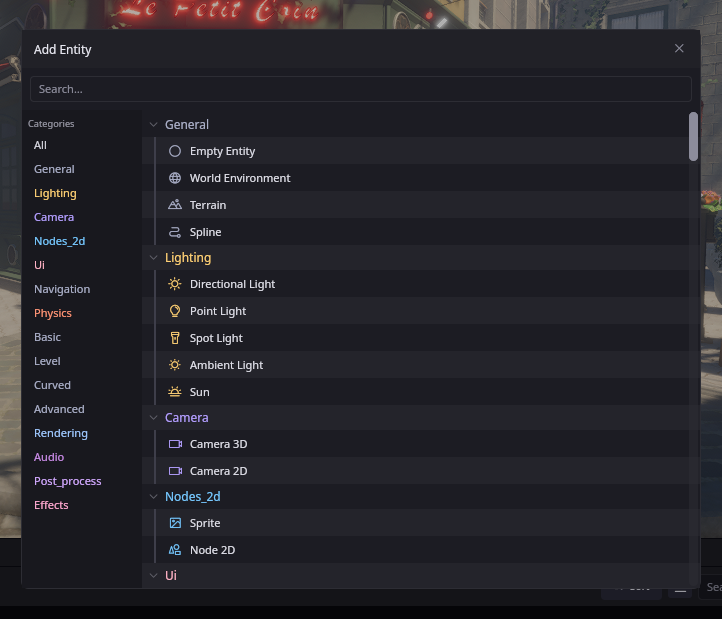

# Scenes and Hierarchy

A scene is your game world: the characters, props, lights and cameras that make up a level or a screen. You build one by arranging objects in the **Hierarchy**, then save it as a file you can reopen and ship.

## The Hierarchy panel

Everything in the current scene, as a tree.



Along the top: **+ Add Entity**, a search box that filters by name, and a filter funnel that narrows the tree to one kind of object.

<!-- screenshot: hierarchy_filter.png - the Hierarchy filter funnel menu open -->

On the right of each row are an **eye** to hide the object and a **lock** to stop accidental edits. Both are undoable.

The eye hides an object, and everything under it, while you edit. It does not hide it in the game unless you turn on **Settings > Project > Hidden Objects Stay Hidden in Game**. Hiding is saved with the scene, so a hidden object stays hidden after an undo, a save or reopening the project. `H` (Hide Selected) works the same way. A scene saved before this behaviour shows its old hidden objects with a closed eye; click it to show them again.

## Adding objects

An empty scene shows a starter screen in place of the tree: a grid of **starters** (Empty Scene, 2D Scene, New Environment, UI Canvas and any a plugin adds), each of which fills the scene with a working arrangement, and below them **Common entities**: Cube, Sphere, Plane, Light, Camera and Empty, each one click. Both are undoable like any other add. **New Environment** gives an outdoor scene ready to work in: sun, sky, clouds and fog over a 2 km sculpted landscape, a flat floor about 850 m across at the centre, in a basin of soft, uneven hills that rise to about 90 m at the edges and a little over 100 m in the corners, with the camera standing on the floor at eye height looking across it at the hills. It is lit as a clear mid-morning: the sun 16 degrees up and a little left of straight ahead, the sky lighting the shadowed slopes at full strength, and a thin haze that half hides the hills at 700 m. Its camera sees 90 degrees across a 16:9 frame, with the ACES filmic curve, bloom from every bright pixel, and auto exposure metering from -10 to 16 EV. These are the starter's own values; the World Environment preset keeps its defaults. The land fills in over a few seconds, nearest the camera first, with a progress card at the top of the viewport; the editor stays usable while it does. The terrain wears the blockout grid like any new terrain; give it a landscape material from the Terrain component. It is ordinary terrain, so it can be sculpted or regenerated too. When the tree is filtered (the UI workspace shows only canvases) the starters narrow to what the filter would show and the common entities are hidden.

Click **+ Add Entity** for a searchable grid of everything you can create, three to a row with each item's icon beside its name, grouped by category.

The category list on the left is a table of contents: clicking a category scrolls the grid to its section (opening it if you had folded it) and leaves the other sections where they are, and the list marks whichever section is at the top as you scroll. **All** opens every section and goes back to the top. Each section starts with a header showing the category, how many items it holds and a rule across the grid; click the header to slide that section shut or open again. Add Component and Add Panel work the same way.



| Group | Holds |
|---|---|
| Presets | Empty Entity, Directional, Point, Spot and Ambient Light, Camera 3D, Camera 2D, Sprite, Node 2D |
| Shapes | Cube, Sphere, Cylinder, Plane, Cone, Torus, Capsule and more |
| Components | A single rendering, post-process, effect or audio component as its own entity |

Installed plugins add their own entries, so the list reflects what your project has loaded.

To skip the search, right-click the empty space below the tree. You get the same list as a menu of categories. Hover one and its entities appear beside it, so a Point Light is a hover and a click away.

Added the wrong thing? `Ctrl+Z`.

## Selecting

| What you do | What happens |
|---|---|
| Click | Select just this object |
| `Ctrl+Click` | Add or remove this object from the selection |
| `Shift+Click` | Select everything between the last pick and this one |
| Double-click | Rename it in the tree |
| `↑` / `↓` | Move to the previous or next visible row |
| `→` / `←` | Open or close the selected branch, then step into or out of it |
| Drag from empty space | Rubber-band select (a plain click there keeps the selection) |
| `Esc` | Deselect everything |

The arrow keys work once you have clicked into the Hierarchy, and they walk what you can actually see. A collapsed group is stepped past, not through.

Selecting a row also expands it, and clicking it again to deselect folds it back. Turn that off under **Settings > Interface > Hierarchy > Toggle on Click** if you are clicking through a deep model and do not want every row unfolding.

## Parenting and reordering

Drag a row to move it. Where you drop decides what happens:

| Drop on | Result |
|---|---|
| The top of a row | Move it just above that row |
| The bottom of a row | Move it just below |
| The middle of a row | Tuck it inside as a child |

Children move with their parent. You cannot drop an object into one of its own children, and the whole move is one undo step.

The order of the top-level objects is saved with the scene, so a scene reopens in the order you left it. A new top-level object goes to the bottom of the list.

Right-click a row for its menu. Each group opens to the side when you hover it:

| Submenu | Holds |
|---|---|
| **Add** | **Empty Entity**, then every kind of thing you can spawn, by category. Whatever you pick is added under this row's entity, at its origin. |
| **Edit** | **Rename**, **Duplicate**, **Unparent**, **Group as Children** (with several selected), **Select as One** / **Select Parts**, **Separate Parts** (on a model part). |
| **Attach** | New files for this entity: Rust Script, Material, Particle, Template, Scene. |
| **Prefab** | **Create Prefab**, or on an instance **Apply to Prefab**, **Revert to Prefab** and **Unpack Scene Instance**; then **Instance Scene…**. See [Prefabs](#prefabs). |
| **Camera** | Cameras only: **Set as Default Camera** and **Snap to Viewport**. |
| **Label Color** | A colour for the row, or **Clear Color**. |

Actions a plugin adds for the entity (such as **Partition into cells**) and **Delete** sit at the bottom.

A label colour shows as a thin line down the left edge of the entity's row and of every row under it, and tints the entity's own icon. The names keep their normal colour.

## Attaching assets

### Creating one on the spot

Hover **Attach** in a row's right-click menu and you get the same new-file list the Assets panel offers: Rust Script, Material, Particle, Template, Scene.

An overlay asks for a **name**, pre-filled with a sensible default, and a **destination folder**, starting on the conventional folder for that type and creating it if you do not have one. An existing file is never overwritten.

For scripts there is also an **Attach to this object** tick, on by default, so a new script is wired up in one step.

### Attaching one you already have

Drag a file from the **Assets** panel onto the object's row. The row lights up as you hover it.

- A **script** is added to the object's Scripts component.
- A **material** is assigned to the object.

The object is selected after the drop, so the Inspector is already showing what you attached. Dropping the same script twice does nothing the second time.

If the row is an imported model's root, a material is applied to every mesh inside it, which is what people usually mean. Drop on a specific child row to change just that mesh.

Dropping a **scene** file instances it instead. See below.

### Asset badges

Objects carrying authored assets show a small badge left of the eye and lock, so you can see what is attached without opening the Inspector. Click a badge to open that asset in its editor: a code icon opens the script, a palette icon opens the material graph.

## Moving things around

Select an object and a gizmo appears. `Q` `W` `E` `R` switch between Select, Move, Rotate and Scale.

There are also Blender-style modal transforms: press `G`, `R` or `S`, move the mouse, click to confirm. `X` `Y` `Z` lock to an axis, `Shift` plus an axis key locks to the plane facing it, and you can type an exact amount. `Esc` cancels.

Full detail is in [Viewport and Camera](/docs/r1-alpha8/editor/viewport).

## Saving

`Ctrl+S` saves the scene. Scenes are `.bsn` files, kept by convention in your project's `scenes/` folder. They are plain text, but the editor writes them for you.

Only named objects are saved. Everything you add through **+ Add Entity** is named for you, so this rarely comes up.

Saving also gives each object a **Scene Entity Id**, a number stored with it in the file. Names can repeat (a duplicated object keeps its name), so the id is what lets the running game find the object you are editing; see [The editor follows the game](/docs/r1-alpha8/editor/play-mode#the-editor-follows-the-game). A duplicate gets a new id of its own on the next save. You never need to set or change it.

### Opening older scenes

A component the editor cannot read is skipped, with a warning naming it, and **the next save writes the scene without it**. Autosave counts as a save. Scenes from older engine versions are translated as they load where the engine knows how: UI layouts saved with the old `Default` alignment value read as `Normal`, entity references in the old numeric form are converted, and components Bevy removed (`FocusPolicy`) are dropped quietly. Saving writes the new format, which an older engine cannot read back, so keep a copy (or commit the project) before opening it in a newer version.

### Scene thumbnails

Every save also snapshots the viewport and keeps it as the scene's thumbnail, so the Assets panel shows you the level rather than a generic icon. Whatever the focused viewport was showing when you saved is the picture you get. Frame the shot, then save.

A scene that has never been saved from the editor keeps its plain icon. This is the only moment the picture is free to take, because reproducing it later would mean loading the whole scene.

### Auto-save

On by default, every 5 minutes. Change it under **Settings > Auto-Save**.

A countdown appears in the status bar in the last few seconds. When it fires it saves the same way `Ctrl+S` does, so a focused material or script tab is never overwritten by it. Auto-save pauses while you are in Play mode.

## Which scene loads first

**Settings > Project > Boot Scene** picks the scene a *game* starts on; so does **Set as Boot Scene** in the top bar's scene switcher, for the scene you are in. It is independent of whatever you are editing. Every save targets the scene you are in (the one the scene switcher names), and nothing writes to the boot scene unless that is the scene you are on. **Save Scene As** is no exception: it saves a copy under the new name and carries on editing that copy, and the boot scene stays where it was.

When a project opens, it reopens the scene and tabs you had open last. One whose file has since been deleted or moved outside the editor is dropped, and the project opens on its boot scene instead.

### How long a project took to open

Every project load is timed, stage by stage, and written to the terminal the editor was started from. Each stage is logged as it is reached:

```
[loading] mcp_test: load started
[loading]       12 ms  scene parsed  (1 model instance(s), 1 model file(s), 82.7 MB)
[loading]     2270 ms  models loaded  (1 model instance(s), 82.7 MB)
[loading]     2410 ms  viewport camera ready
```

and once everything has arrived, the whole load as one table, with the gap between each stage and the one before it:

```
[loading] mcp_test: loaded in 9120 ms
       12 ms  (+   12 ms)  scene parsed  (1 model instance(s), 1 model file(s), 82.7 MB)
     2270 ms  (+ 2258 ms)  models loaded  (1 model instance(s), 82.7 MB)
     ...
  longest frame 1840 ms; 3 frame(s) over 250 ms stalled the editor for 2900 ms in all
```

| Stage | What it means |
|---|---|
| scene parsed | The scene file has been read and its entities created |
| models loaded | Every model file the scene names has been read from disk |
| model asset added | Bevy has the model asset itself (the first one, when there are several) |
| model scene asset added | Bevy has the scene inside the model, which is what gets instantiated |
| model loaded with dependencies | Every texture and file the model names has loaded as well |
| model instantiated by Bevy | Bevy has created every entity of a model; the time from here to the next stage is the editor's own work on it |
| models spawned | Every model's meshes exist in the scene |
| viewport camera ready | The viewport has a camera to draw with; until then it is black |
| editor opened | The loading screen has gone and the editor is showing |
| textures loaded | Every texture the scene's materials use has arrived (or failed, which is counted) |
| materials resolved | Every mesh has been given its material |
| shaders compiled | No render pipeline is left queued or compiling. Each graph material has its own shader, so a scene with many materials spends a while here, and a mesh draws nothing until its pipelines exist |
| virtual geometry ready | Every model's virtual geometry has loaded; until then a model is drawn as ordinary meshes |
| environment lighting filled | The viewport's sky lighting has been computed; until then surfaces get no light from the sky |

When the load finishes, the table ends with what each kind of asset holds: the CPU copies of meshes and images, the virtual geometry files, an estimate of the images' size on the GPU, and how much of the editor's committed memory is outside the assets altogether (the GPU driver's copies and staging, render buffers, compiled pipelines, the allocator's reserve). The images row also says how much of it comes from files and names the ten largest, by path or, for an image the engine made itself, by label, size and format, with alike images counted together, render targets marked as such, and the font atlases text keeps its drawn glyphs in counted apart, with how many fonts and sizes they cover and the sizes most of them are for. If any UI text is being laid out again on every frame, the same row says how much and where it sits in the UI, since that is the usual way atlases pile up. Where the graphics backend can report it (Direct3D 12 and Vulkan), a GPU allocations row gives what the GPU allocator has handed out, what it has reserved in memory blocks behind that, and the labels holding the most: buffers, render targets and ray-tracing structures all come from there, and on Windows the reserved blocks in system memory count toward the editor's committed memory. With the MCP Server plugin, `memory_report` gives the same breakdown at any moment, to measure what an action allocates and whether it gives it back.

On Windows and Linux every stage also records the editor's memory, resident (what Task Manager shows) and committed, with how much committed memory grew since the stage before, so a load that ends far heavier than its files says which stage allocated it. Where the backend can report it, each stage also gives what the GPU allocator holds and has reserved, with how much its reserve grew, so a stage's growth can be split between the GPU and the editor's own memory.

The loading screen closes once the models have spawned, so textures, virtual geometry and the sky lighting can arrive after the editor opens, and the timeline keeps following them. The frame line at the end counts frames that took a quarter of a second or more: time the editor did not respond at all. A load that has not settled after two minutes is closed with what it was still waiting on.

The memory breakdown under the timeline also lists the file textures no material uses, grouped by folder, with how many handles still hold each folder's textures. A model's textures should be freed together with its materials. If its folder still appears there after its scene tab has closed, something kept the textures, and the handle count tells you how many references are left.

With the MCP Server plugin installed, an assistant can read this with `project_load`, and with `reload` reopen the project and time a fresh load, to compare before and after a change. A reload is warm: the models are often still in memory. To time the cold load you wait through after starting the editor, use `wait` and open the project from the launcher.

A crate can add a stage of its own: take `Option<ResMut<renzora::load_timeline::LoadTimeline>>` and call `mark("stage name", "detail")`. It is recorded the first time only, and only while a load is running.

### Global scenes

A global scene loads before the boot scene and stays alive through every later scene change. Use one per concern: a HUD scene, a music scene, a networking scene.

Set them under **Settings > Project > Global Scenes**.

Everything a global scene spawns is marked persistent, so scene loads skip it and scene saves never bake it into the level you have open. Play runs your game, which loads them exactly as an exported game does, so you can test without exporting.

This is also the only place a loading screen can work, because everything in the outgoing scene is despawned partway through a scene change. Only a global scene's script is still running to show progress.

A loading screen reads `asset_progress()`, which stays at `"loading"` after a scene loads until the scene is ready to be seen: its models are in, its terrain is built, its materials are resolved, and textures and shaders have stopped arriving for half a second. It waits as long as that takes; if a scene is still loading after 30 seconds, the log says what it is waiting for, which finds a load that never ends (a material whose file is missing). Terrain streaming in or textures loading while the game plays do not bring it back.

## Prefabs

A prefab is something you build once and place many times: a prop, an enemy, a player, a room. It is a scene file, and every placed copy is an **instance** of it. Change the prefab and every instance changes.

### Making one

Right-click an object in the Hierarchy and choose **Prefab ▸ Create Prefab**. The object and everything under it are saved to `prefabs/<name>.bsn`, and the object is replaced in place by an instance of that file, so nothing moves. **Ctrl+Z** puts the original object back (the file stays).

The object you picked becomes the prefab's top object, under a new instance row that holds where this copy is placed. A script on that top object that wants the placed copy, rather than its own part of it, looks at its parent.

### Placing one

- Drag the `.bsn` from the Assets panel onto the **viewport**. It lands under your cursor.
- Drag it onto the **Hierarchy**. It is added at the scene root.
- Right-click in the Hierarchy and choose **Prefab ▸ Instance Scene…**.

Any scene file can be placed this way, not only the ones in `prefabs/`.

### Changing one

Edit inside any instance, then push the change out:

| Action | Where | What it does |
|---|---|---|
| **Apply to Prefab** | Hierarchy right-click **Prefab** menu, or the **Prefab Instance** card in the Inspector | Saves this instance's contents to the prefab file and rebuilds every other instance in the scene from it. |
| **Revert to Prefab** | the same places | Throws away this instance's edits and rebuilds it from the file. **Ctrl+Z** brings them back. |
| **Unpack Scene Instance** | Hierarchy right-click **Prefab** menu | Breaks the link: the contents become ordinary objects. |

Saving the scene saves the edits of a prefab that is placed **once** back to its file for you. A prefab placed several times is left alone on save, because the editor cannot tell which copy's edits you meant: use **Apply to Prefab** on the one you want. Apply cannot be undone, because it writes a file other scenes may use.

What a scene stores for an instance is only its placement. Its contents always come from the file. A scene cannot contain an instance of itself.

### Spawning one while the game runs

```rust
use renzora::core::prefab::spawn_prefab;

let coin = spawn_prefab(ctx.world(), "prefabs/coin.bsn", Transform::from_xyz(2.0, 0.5, 0.0));
```

The contents arrive on the next frame. A language plugin's `spawn_prefab(path, position, rotation)` does the same. For a prefab every player should see, spawn it with `renzora::network::spawn_prefab` on the server instead (see [Multiplayer](/docs/r1-alpha8/multiplayer/overview)).

## Shortcuts

`Ctrl+N` new, `Ctrl+O` open, `Ctrl+S` save, `Ctrl+Shift+S` save as, `Ctrl+D` duplicate, `Delete` delete, `F` focus the selection.

The full list is in [Keyboard Shortcuts](/docs/r1-alpha8/editor/shortcuts).
