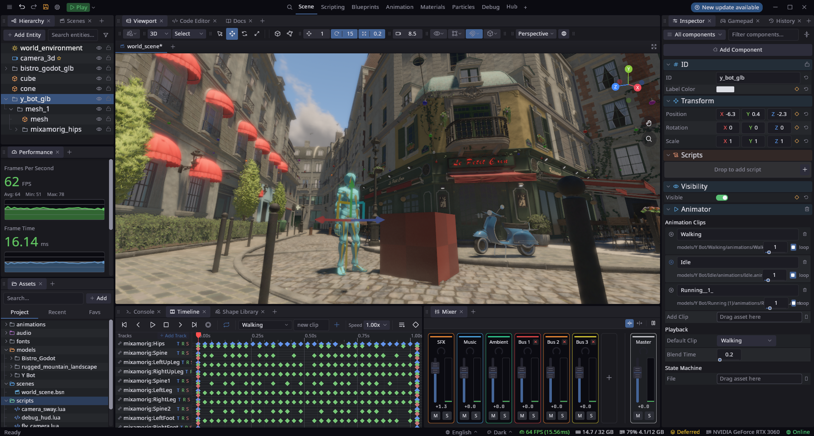

# Installation

Download Renzora, run it, and you are in the editor in a few minutes.

## System requirements

| | Minimum |
|---|---|
| Windows | Windows 10, 64-bit |
| macOS | macOS 12 Monterey |
| Linux | Any x86_64 or ARM64 distro with glibc 2.28 or newer: Ubuntu 20.04, Linux Mint 20, Debian 10, Fedora 29, RHEL / Rocky / AlmaLinux 8, Pop!\_OS 20.04, or current Arch, openSUSE Tumbleweed and NixOS. Wayland or X11. |
| Graphics | A GPU with Vulkan, Metal or DX12 |
| Memory | 4 GB, 8 GB recommended |

## Download the editor

Grab a build for your platform from [renzora.com/download](/download). Nothing else to install.

**Windows.** Extract the `.zip` anywhere and run `renzora.exe`.

**macOS.** Extract the `.zip` and move the app to your Applications folder. The app is signed but not notarized, so the first launch is blocked. Open **System Settings > Privacy & Security**, find the message naming Renzora Engine, and click **Open Anyway**. You only do this once.

**Linux.** Extract the `.zip`, make the `.AppImage` inside it executable (`chmod +x`), and run it. On most desktops that is all. [Installing on Linux](/docs/r1-alpha8/getting-started/linux) has the packages for each distro, the setup for NixOS, Steam Deck and immutable distros, and what to do if it does not start.

The AppImage carries a `renzora-engine.desktop` entry and its icon, and the editor window claims `renzora-engine` as its Wayland `app_id` (X11 `WM_CLASS`), which is the string a desktop shell matches a running window to its launcher by. So installing the entry gets you the right icon in the dock, and pinning it associates with the running editor rather than sitting beside it. A game you export claims no such identity, because that one belongs to the editor.

### Nightly builds

Alongside numbered releases there are nightly builds, tagged like `r1-alpha8-nightly-16aug26`. They carry the newest fixes and the newest bugs. Use one if you are working closely with engine changes. Do not ship a game on one.

## Keeping it up to date

The editor updates itself. **Help > Check for Updates** downloads the new version and installs it in place. When a startup check has already found one, the menu item names the version instead, and an update chip appears in the top bar.

The dialog walks you through Download, then Install and Restart. The download is checksummed, and if anything goes wrong while files are being replaced your existing install is put back.

| Option | What it does |
|---|---|
| Install to | The folder that gets replaced. Defaults to where the editor is running from. |
| Skip This Version | Stops the top bar mentioning the version on offer. The next release asks again. |
| Channel | **Auto** follows what you are running, **Stable** offers releases only, **Nightly** offers dated builds of `main`. |

Nightly requires Dev Mode, which sits under the channel picker and in **Settings > Editor**. With Dev Mode off, every channel resolves to Stable.

### Plugin updates

Under the engine's own versions the dialog lists any installed plugins with a newer version published, because "am I up to date?" is one question and splitting the answer across two screens means half of it never gets read.

**Update plugins** hands off to the marketplace's **Updates** view, which is where a plugin is actually installed from. A plugin update that needs a newer editor than you are running is listed with a lock rather than an arrow: it is waiting on the very update this dialog is offering.

See [Browsing & Installing](/docs/r1-alpha8/marketplace/browsing) for the rest, including how to turn the startup reminder off.

## What's next

- [The Dashboard](/docs/r1-alpha8/getting-started/dashboard) is the first screen you see.
- [Core Concepts](/docs/r1-alpha8/getting-started/concepts) explains scenes, entities and components.
- [Your First Project](/docs/r1-alpha8/getting-started/first-project) builds something.
